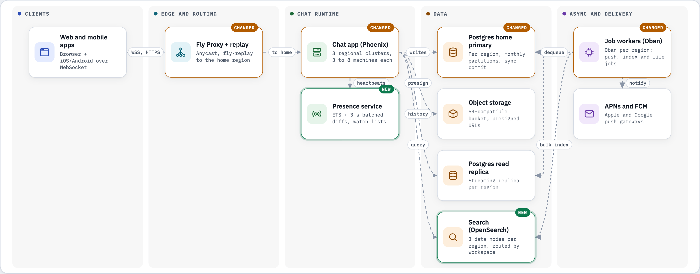
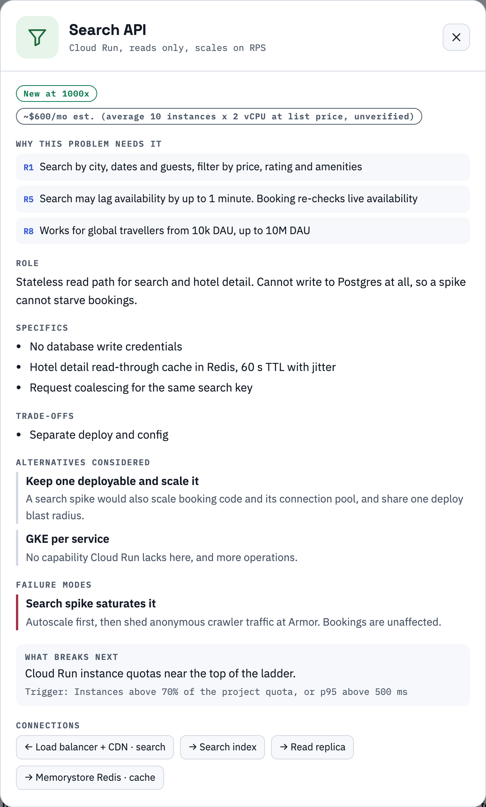
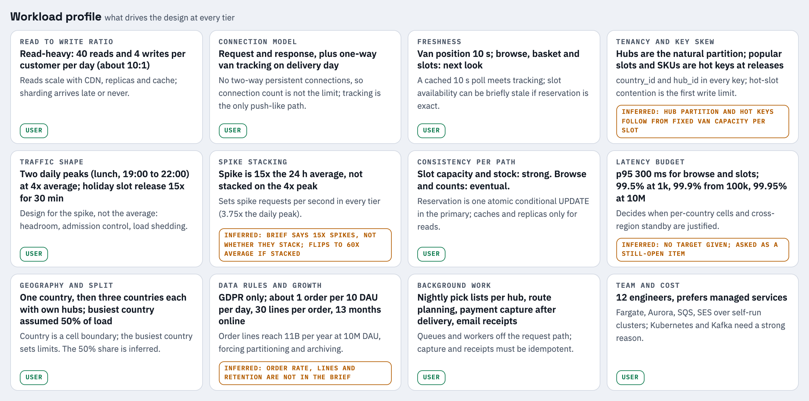

# archladder

**Staff-level system design that starts from your repo, asks before it assumes, and climbs a ladder
from 1k to 10M daily users.**

archladder is an agent skill for Claude Code (and other agents that read `SKILL.md`). Point it at a
brief, a ticket or a problem, and it:

1. **Reads your project first.** README, specs, ADRs, manifests, hosting and database config,
   migrations, the code behind your hot paths. Every fact goes into a context ledger with its
   source.
2. **Interviews you instead of guessing.** Anything it can't find becomes a question, with its
   assumption, the evidence, options with a recommendation, and room for your own answer. Questions
   come in priority order: scope first, then one-way doors, then the numbers.
3. **Profiles the workload.** Read-heavy or write-heavy, request and response or two-way
   connections, steady or bursty, single or multi-tenant, one region or global, data residency. Two
   systems with the same user count need different designs, and the profile is what decides.
4. **Climbs the ladder** when scale is in play. Five tiers, 1k, 10k, 100k, 1M and 10M daily users.
   Each tier changes only what the profile and the numbers force, names the trigger metric, and
   lists what was considered and left out.
5. **Builds an interactive design page.** Clickable components with role, trade-offs, alternatives
   considered, failure modes and what breaks next, plus animated request and async flows, NEW, CHANGED and REMOVED badges, and
   light and dark themes. One self-contained HTML file.

Every page carries a banner saying it's an AI-generated suggestion to verify. It recommends and never decides. It changes no code. The output ends in a numbered list of decisions
for you.

## See it

<picture>
  <source media="(prefers-color-scheme: dark)" srcset="docs/screenshots/diagram-dark.png">
  
</picture>

**[Try the live examples](https://khubaibqaiser.github.io/archladder/)**: switch tiers, hover a component
to trace its connections, click it for the details.

<table>
<tr>
<td width="50%">
<picture>
  <source media="(prefers-color-scheme: dark)" srcset="docs/screenshots/modal-dark.png">
  
</picture>
<p align="center"><sub>Click any component for its role, alternatives, failure modes and what breaks next.</sub></p>
</td>
<td width="50%">
<picture>
  <source media="(prefers-color-scheme: dark)" srcset="docs/screenshots/profile-dark.png">
  
</picture>
<p align="center"><sub>The workload profile drives every tier, and each row shows where it came from.</sub></p>
</td>
</tr>
</table>

## Examples

Each example is a fictional product: a short brief, the interview answers archladder was given, and
the page it generated. They're not affiliated with any real company.

| Example | Brief | Page | What drives the design |
|---|---|---|---|
| Grocery delivery app | [brief](examples/grocery-delivery/brief.md) | [page](https://khubaibqaiser.github.io/archladder/examples/grocery-delivery/) | Delivery slots that must never oversell, bursty slot releases, nightly picking |
| Hotel booking marketplace | [brief](examples/hotel-booking/brief.md) | [page](https://khubaibqaiser.github.io/archladder/examples/hotel-booking/) | 200 searches per booking, campaign spikes, never double-book the last room |
| Team chat app | [brief](examples/team-chat/brief.md) | [page](https://khubaibqaiser.github.io/archladder/examples/team-chat/) | Two-way sockets, ordered fan-out to 50k-member channels, tenant skew |

Same ladder, three different climbs: the profile, not the user count, decides what each tier adds.

## Install

**Claude Code plugin**

```
/plugin marketplace add KhubaibQaiser/archladder
/plugin install archladder@archladder
```

**As a plain skill (Claude Code)**

```bash
git clone https://github.com/KhubaibQaiser/archladder ~/.claude/skills/archladder
```

Or download `archladder.zip` from the [latest release](https://github.com/KhubaibQaiser/archladder/releases/latest)
and unzip it into `~/.claude/skills/`.

**Other agents** (Codex CLI, Cursor, OpenCode and others that load `SKILL.md` skills): copy the
folder into that agent's skills directory. Without Claude Code's `AskUserQuestion` tool, the
interview falls back to numbered questions in plain text.

## Use

```
/archladder docs/BRIEF.md
/archladder Make the pipeline board collaborative with live presence, plan for growth
/archladder https://github.com/org/repo/issues/123
```

Or just ask: "break down this ticket", "how does this scale to a million users", "pressure-test
this design".

Expect a round or two of questions before any design. That's the point.

## What you get

A summary of about 150 words comes first: the recommendation, what drives it, and the decisions
you need to make. The detail follows, sized to the problem, so a small change gets a short reply:

1. Problem, context ledger and workload profile
2. Options, with one-way and two-way doors marked
3. Library comparison
4. Lens findings: concurrency, idempotency, security, front-end data, pagination vs virtualization,
   data model, real-time transport, scale
5. Edge cases
6. System design from 1k to 10M DAU, with a scale path table (only when scale is in play. A
   one-screen change gets one line instead.)
7. Risks
8. PR-sized deliverables with a dependency graph
9. Decisions for you
10. Still open

Plus the interactive design page, offered for publishing or saved to a path you choose.

## Layout

```
SKILL.md                      the skill
references/lenses.md          the review lenses
references/scaling.md         workload profile, tier maths, scaling playbook
references/design-schema.md   the DESIGN object the page renders
assets/system-design.html     the page template (stack-free skeleton)
scripts/check-design.mjs      validates a generated page
evals/                        test cases for `claude plugin eval`
examples/                     example briefs and the pages they produced
docs/                         the GitHub Pages site and README screenshots
.claude-plugin/               plugin and marketplace manifests
```

Check any generated page (Node 18 or later, no dependencies):

```bash
node scripts/check-design.mjs path/to/page.html
```

## Contributing

Examples from real projects are the most useful contribution. See [CONTRIBUTING.md](CONTRIBUTING.md).

## License

[MIT](LICENSE) © Khubaib Qaiser
